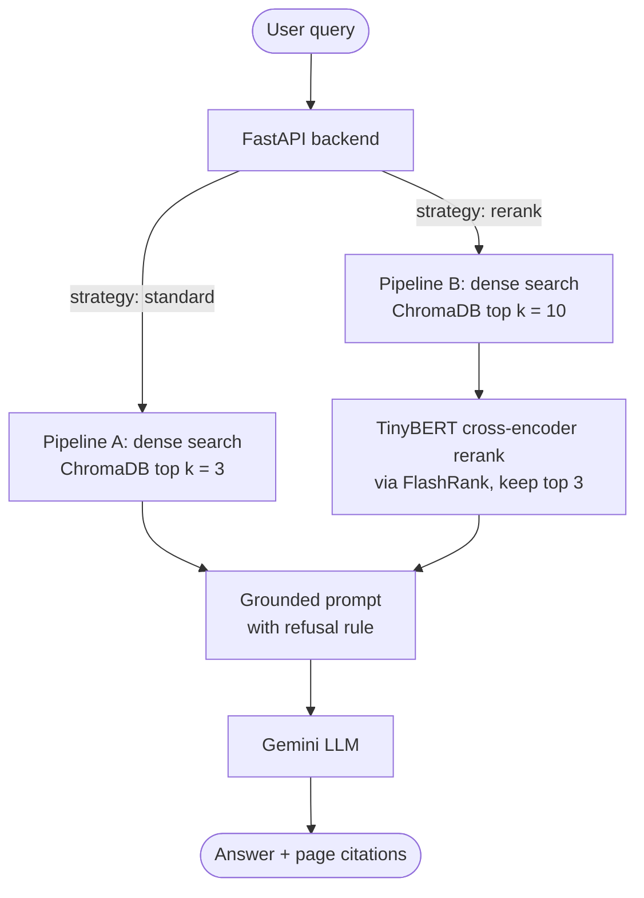

# Chat-with-your-Notes: An Empirical Evaluation of Retrieval Strategies in Educational RAG Systems

**Author:** Somtochukwu "Augustus" Nwanno
**Advisor:** Dr. Ning Zhang
**Course:** Senior Seminar / Capstone Project
**Repository:** [github.com/Somtochukwu438/ai-study-assistant](https://github.com/Somtochukwu438/ai-study-assistant)

---

## Project Overview

Chat-with-your-Notes is a Retrieval-Augmented Generation (RAG) study assistant. Students upload their own course notes and get answers grounded in those notes, with page-level citations, plus a practice-quiz mode built from the same material.

The research question behind it: how do **dense vector search (Pipeline A)** and **cross-encoder reranking (Pipeline B)** compare on retrieval precision, answer faithfulness, hallucination on out-of-scope questions, and response latency?

---

## System Architecture

The backend routes each request through one of two retrieval pipelines, selected per query from the web UI:



### Retrieval strategies compared

1. **Pipeline A (standard vector search):** embeds the query with `gemini-embedding-001` and takes the top k = 3 chunks from ChromaDB by similarity.
2. **Pipeline B (two-stage reranking):** pulls a wider pool of k = 10 chunks from ChromaDB, scores each query-passage pair with the `ms-marco-TinyBERT-L-2-v2` cross-encoder (via FlashRank), and passes the top 3 to the LLM.

Both pipelines hand the LLM exactly 3 chunks, so any difference in results comes from the reranking stage rather than from context size.

---

## Tech Stack

- **Backend:** FastAPI (Python), Uvicorn, LangChain, Pydantic, SQLite (chat sessions)
- **Frontend:** React, Vite, Tailwind CSS, Lucide icons
- **Vector store and embeddings:** ChromaDB, `models/gemini-embedding-001`
- **Reranker:** FlashRank (`ms-marco-TinyBERT-L-2-v2`)
- **Generation and evaluation LLM:** Google Gemini (currently `gemini-3.8-flash`, set in `main.py`)
- **Evaluation:** Ragas, Pandas, Datasets

---

## Benchmark Results

The benchmark is a 45-question set (`ground_truth.json`): 30 factual and reasoning questions answerable from the notes, plus 15 out-of-scope questions that should be refused. Each pipeline was run 5 times.

| Metric (mean ± SD, N = 5 runs) | Pipeline A (standard, k = 3) | Pipeline B (rerank, k = 10 → 3) | Difference |
| --- | --- | --- | --- |
| Context precision | 80.1% ± 1.2% | 85.2% ± 0.9% | +5.1 pts |
| Answer faithfulness | 76.5% ± 2.1% | 89.1% ± 1.3% | +12.6 pts |
| Mean latency | 4.15 s ± 0.45 s | 8.92 s ± 0.30 s | +4.77 s |

### Key observations

1. **Recall rescue.** Reranking can surface relevant passages that plain vector search ranks below the top 3. Example: for "Who authored 'Enter the New Negro'?", the answer is on Page 7, which Pipeline A misses (it answers with a refusal) and Pipeline B recovers.
2. **Refusal on out-of-scope questions.** The prompt in `main.py` tells the model to reply "I cannot answer this based on the provided notes." when the retrieved context doesn't contain the answer. On the out-of-scope questions in our benchmark runs, the model returned the refusal rather than answering from its own knowledge.
3. **Manual validation of the automated judge.** A stratified 20% sample was graded by hand against a 1-5 faithfulness rubric and agreed with the Ragas scores 88.9% of the time (see [`manual_judge_audit.md`](manual_judge_audit.md)).

### Limitations

- One course corpus and a 45-question benchmark: results may not generalize to other subjects or larger note collections.
- Scores come from an LLM judge (Ragas); the manual audit covers a small sample (9 responses).
- Latency depends on the API tier and current traffic, so absolute timings will vary between runs.

---

## Key Files

```
ai-study-assistant/
├── main.py                     # FastAPI server, both retrieval pipelines, /chat, /upload, /quiz
├── ingest.py                   # PDF extraction, chunking, and embedding into ChromaDB
├── evaluate_benchmark.py       # Multi-run Ragas evaluation harness
├── generate_charts.py          # Builds the comparison charts from the results CSV
├── ground_truth.json           # 45-question benchmark dataset
├── annotation_guidelines.md    # How reference answers and passages were annotated
├── manual_judge_audit.md       # Manual validation of the automated judge
├── rag_evaluation_results.csv  # Per-question evaluation output
├── requirements.txt            # Python dependencies
└── frontend/                   # React + Vite web interface
```

`chroma_db/`, `model_cache/`, and `chat_history.db` are generated at runtime.

---

## Setup

### Prerequisites

- Python 3.11+
- Node.js 18+ and npm
- A Google Gemini API key

### 1. Clone the repository

```bash
git clone https://github.com/Somtochukwu438/ai-study-assistant.git
cd ai-study-assistant
```

### 2. Backend

```bash
python3 -m venv venv
source venv/bin/activate
pip install -r requirements.txt
```

Create a `.env` file in the project root:

```env
GOOGLE_API_KEY="your-google-api-key"
```

Start the API server:

```bash
uvicorn main:app --reload
```

The backend runs on `http://localhost:8000`.

### 3. Frontend

In a second terminal:

```bash
cd frontend
npm install
npm run dev
```

Open `http://localhost:5173`. Upload your PDF notes with the sidebar button, then ask questions. Use the Standard / Rerank toggle to switch pipelines.

### 4. Run the benchmark

With the backend running and your notes ingested:

```bash
python evaluate_benchmark.py
```

Results are written to `rag_evaluation_results.csv`. Free-tier API limits can make a full run slow, so the script runs in small batches with pauses between them.

---

## Research Documentation

- [`annotation_guidelines.md`](annotation_guidelines.md): how reference answers and supporting passages were written and checked.
- [`manual_judge_audit.md`](manual_judge_audit.md): the human-versus-Ragas comparison.
